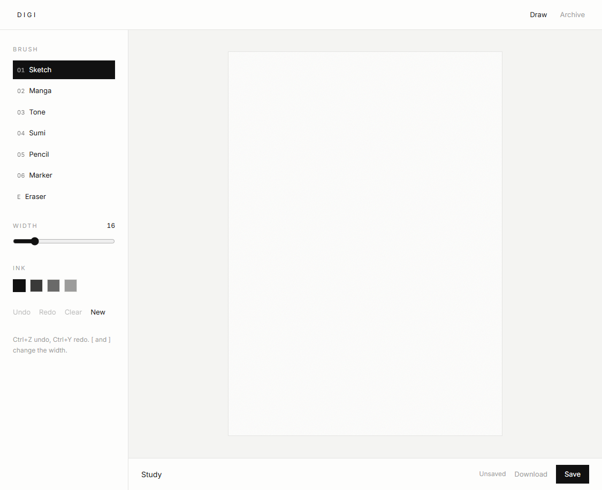

# Digi

A private drawing desk for sketch, manga, tone, sumi, pencil, and marker.



## Setup

1. Copy `.env.example` to `.env.local`
2. Set `SUPABASE_URL` and `SUPABASE_SERVICE_ROLE_KEY`
3. Apply migrations in `supabase/migrations/`
4. Run the desk:

```bash
npm run dev
```

Open `/` to draw and `/archive` to browse saved sheets.

## Desk

- Brushes: Sketch, Manga, Tone, Sumi, Pencil, Marker, plus Eraser
- Ink: Sumi, Charcoal, Stone, Ash
- Shortcuts: `Ctrl+Z` undo, `Ctrl+Y` redo, `[` / `]` width, `1`–`6` brushes, `E` eraser
- Save stores strokes in Supabase; Download exports a PNG
- Unsaved work is kept as a local draft

## Scripts

```bash
npm run lint
npm run typecheck
npm run build
```
